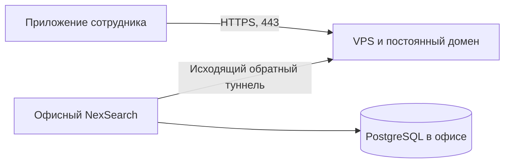

# NexSearch: доступ извне без VPN

Рассмотрено 26 октября 2026 года. Это проект следующего изменения, а не описание включённого доступа. Сейчас программа использует локальную сеть и проверку закреплённого сертификата хоста.

## Предлагаемая схема

Офисный сервер сам подключается к шлюзу с публичным адресом. Шлюз передаёт запросы сотрудника обратно по этому соединению. Белый IP и проброс порта на офисном роутере не нужны; VPN-клиент сотруднику не нужен. Данные и PostgreSQL остаются на офисном сервере. Публичная точка всё равно необходима: это инфраструктура провайдера туннеля или собственный VPS.

Для существующего NexSearch наиболее прямой вариант — frp в режиме перенаправления TCP, с HTTPS приложения внутри туннеля. Это архитектурный вывод из поддержки TCP в [официальной документации frp](https://gofrp.org/en/docs/overview/) и текущей проверки сертификата в network/client.py. Шлюз передаёт зашифрованный поток; сертификат и ключ NexSearch остаются в офисе. Публичный TLS-порт шлюза и туннель нельзя завершать на обычном HTTP-прокси, если требуется сохранить нынешнюю проверку сертификата без изменения модели доверия.

## Что требуется добавить в NexSearch

1. Профиль «Через интернет» с постоянным доменом, который администратор включает в комплект сотрудников. Программа проверяет подлинность хоста перед входом и подключается без ручного ввода адреса сотрудником. Сейчас обнаружение адресов предназначено для локальной сети; простой запуск туннеля этого не изменит.
2. Раздельные состояния локального и внешнего подключения, переключение и проверка восстановления после обрыва. Загрузки обновлений, Excel, почтовые вложения и уведомления должны использовать выбранное соединение.
3. Отдельные отзываемые ключи туннеля, хранимые на серверах; в общий клиентский комплект не помещается универсальный привилегированный секрет. Сотрудники продолжают входить под личными аккаунтами NexSearch. Секреты не передаются через чат.
4. Автозапуск и переподключение службы туннеля, ограничения доступных портов и журнал подключения. PostgreSQL, административный SSH и служебные панели напрямую сотрудникам не публикуются.
5. Проверка на офисном провайдере и у удалённых сотрудников: вход, разделение доступа, длительная сессия, потеря сети, скачивание большого обновления, вложения и сохранение данных.

Нужны VPS с публичным адресом и постоянное имя. Ресурсы и провайдер выбираются после проверки реальных сетей и нагрузки; устойчивость конкретного маршрута пока не проверена.

## Cloudflare Tunnel

[Официальная документация Cloudflare](https://developers.cloudflare.com/tunnel/concepts/) подтверждает исходящее соединение из офиса без публичного адреса и открытых входящих портов. Для постоянного опубликованного приложения нужны аккаунт и домен; временный Quick Tunnel не является постоянным адресом для рабочего комплекта.

У Cloudflare HTTPS обычно завершается на пограничном сервере. Поэтому текущий клиент NexSearch, ожидающий сертификат офисного хоста, не сможет просто использовать публичный Cloudflare-адрес. Потребуются доверенный HTTPS-профиль и отдельная криптографическая проверка личности хоста, а не отключение проверки сертификатов. Cloudflare Access также требует интеграции авторизации с клиентом; HTML-страница входа не заменяет ответ API. [Параметры TLS origin](https://developers.cloudflare.com/tunnel/reference/origin-parameters/), [service tokens](https://developers.cloudflare.com/cloudflare-one/access-controls/service-credentials/service-tokens/).

Для сотрудников из России нельзя обещать надёжность этого маршрута: в [официальном сообщении Cloudflare, обновлённом 23 апреля 2026 года](https://developers.cloudflare.com/support/troubleshooting/general-troubleshooting/service-disruption/), описаны ограничения трафика российскими провайдерами. Это не проверка конкретного офиса, но существенная причина сначала испытать маршрут и иметь альтернативу.

Предложение: начать с собственного VPS и TCP-туннеля к HTTPS NexSearch. Cloudflare рассматривать как отдельный испытательный вариант, если соединение действительно проходит в нужных сетях.
