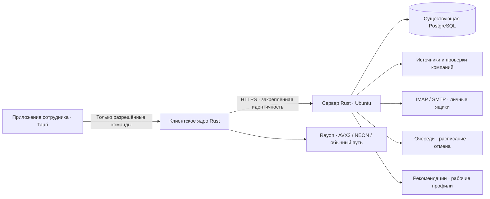

# Переход 1.6.7 → 2.0

**Актуальное решение:** интерфейс не переделывается. Основой служит исходная 1.6.7; см. [UI-POLICY.md](UI-POLICY.md). Описанные ниже учебные экраны относятся к отвергнутому прототипу, а не к текущему основному окну. Совместимый Rust-транспорт позволяет переносить внутренности за существующим интерфейсом. Все рабочие серверные функции ещё требуется перенести и проверить.

## Устройство

Это целевая архитектура. В alpha.1 десктоп работает с учебной памятью, а сервер предоставляет только отдельную проверку здоровья. Стрелки к рабочей БД, источникам, почте и TLS ещё предстоит реализовать и проверить.

## Что переносим и как принимаем

| Направление | Состояние alpha.1 | Условие готовности |
|---|---|---|
| Tauri, русский интерфейс, темы | Основа и рабочие личные настройки | Нативные проверки Windows / Intel Mac / ARM Mac; весь пользовательский текст на русском, кроме брендов и стандартных обозначений |
| Сервер и PostgreSQL | Только изолированный `/health` | Перенесены авторизация, все операции CRM, транзакции, RLS, события, резервное копирование и служба Ubuntu |
| Поиск по ИНН и критериям | Правила и учебный каталог | Реальные источники, проверки Чекко/ФНС с датами, глобальная дедупликация, 1–50 результатов, остановка, расписание, 4 одновременных сотрудника |
| Клиенты и руководство | Учебный общий обзор, досье и передача | Сохранена реальная история, личные этапы, контакты, часовые пояса; руководитель видит свой отдел, директор всех; поиск доступен каждой должности |
| Задачи и уведомления | Учебное создание задачи и локальные уведомления | Реальные назначения сотрудникам, сроки, повторения, переход в досье, уведомления о просрочке руководству и всплывающие уведомления |
| Перевозчики | Ещё не переносились | Общая база, ИНН после названия, отдельные телефон/почта/условия НДС, автопарк под описанием, тонны/метры, фильтры по направлениям и технике |
| Почта | Макет и модель цепочек; баг исправляется также в 1.x | Ящики сотрудников, папки/вложения/подписи, входящие сверху, ответы и HTML-картинки, 60 секунд автообновления, ограниченные повторы, нет вечной синхронизации |
| Умный подбор | Объяснимые правила и тестируемая малая модель | Профиль собирается из видимых рабочих результатов, есть управление предпочтениями, отложенный поиск и глобальная дедупликация; качество сравнивается с правилами |
| Личные сервисы | Добавление, удаление и сохранение ссылки | Синхронизация личных настроек через хост, подтверждённая изоляция сотрудников, безопасная отдельная область для стороннего сайта |
| Карты, ставки и инструменты | Ещё не переносились | Сохранены все инструменты 1.6.7, нет дублирующего выбора маршрута, есть дата источника ставки, переключатели удобны в обеих темах |
| PackOnTruck | Ещё не переносился | Все существующие тралы и оси, верная геометрия, вращения, ярусы, м/см/мм, т/кг, центр тяжести, нагрузки на каждую ось, сохранение проектов и выгрузка |
| Excel / импорт / экспорт | Ещё не переносились | Открытие в Excel/LibreOffice, защита от формульной инъекции, работа с русскими именами файлов, корректная отмена сохранения |
| Автообновления | Не включены для alpha | Подпись пакета, проверка роли и версии, атомарная замена, откат, автоматический старт хоста, понятный прогресс и обновление сотрудника одной кнопкой |

## Порядок переноса

1. Закрепить начальную сборку и тесты, закрыть подтверждённые причины сбоев 1.x. Снять перечень текущих операций и договориться об измеримых критериях совместимости. **Начато.**
2. Перенести PostgreSQL-доступ и авторизацию на Rust. Сохранить UUID сотрудников и компаний, Argon2id, роли, отдел, права доступа и историю. Пароли и хеши не отдавать приложению; сеанс подтверждает сервер.
3. На восстановленной **копии** базы выполнить сверку количеств записей, владельцев, ИНН, этапов, задач, контактов, автопарков, писем и аудита. Ключи шифрования почты и идентичность сервера сохраняются; иначе пароли ящиков невозможно восстановить без повторного ввода.
4. Перенести поиск и серверный планировщик. Отмена доходит до HTTP-запросов, проверок и очереди; общий пул запросов к источнику ограничен независимо от числа сотрудников. Дубликат исключается атомарной транзакцией/ограничением PostgreSQL, а не только списком в памяти.
5. Завершить CRM, задачи, уведомления, перевозчиков и почту. Старые файлы интерфейса с многократным переопределением обработчиков не переносятся цепочкой: каждый раздел владеет своим состоянием, запросами и жизненным циклом.
6. Перенести расчёты погрузки и проверить их на эталонах: сумма реакций равна общему весу, сумма моментов уравновешена, положение/число осей соответствуют модели, негабарит и центр тяжести не нарушают пределы. Суммарная нагрузка группы не должна выдаваться за точно измеренную нагрузку каждой оси без модели подвески.
7. Подключить сбор рабочей истории для рекомендаций. Начальные правила остаются базовой линией; малая модель используется только при достаточной истории с обоими исходами. Не дообучать модель на её же неподтверждённых предложениях. Показать сотруднику причину рекомендации, руководителю — причину выбора ответственного.
8. Прогнать полный набор проверок на Windows, Ubuntu, Intel и ARM Mac, включая соединение через существующий VPS-туннель, пропадание сети и возобновление работы. Лишь затем выпускать подписанную 2.0 в рабочие ветки.

## Обязательный прогон перед выпуском

- Одна и та же компания не достаётся двум сотрудникам при одновременном поиске. Руководители тоже получают и передают клиентов.
- Быстрые переходы «Клиенты → Перевозчики → Клиенты» и запоздалые ответы не смешивают данные.
- Обрыв IMAP, неверный пароль, медленный сервер, повторная проверка, отказ БД и отмена возвращают конечный статус и освобождают ресурсы.
- Почтовый HTML не запускает сценарии, не читает файлы, не вызывает Tauri-команды и не отслеживает сотрудника удалёнными изображениями без выбранной политики загрузки.
- Один сотрудник не читает чужую почту даже с ролью руководителя; доступ к клиентам проверяется сервером и БД.
- Миграция сохраняет все записи и проверяется восстановлением резервной копии. Процедура отката проверяется до подключения настоящей базы.
- Запуск на машине без AVX2 работает; ARM не получает x86-инструкций; CPU-нагрузка не блокирует интерфейс и отмену.
- Проверяется именно собранный установщик с автоматическим обновлением. Успешная локальная компиляция не считается выпуском.

## Исправление почты в 1.x

Ручная и автоматическая проверки одного ящика объединяются в текущую операцию вместо постоянной ошибки «Почта уже синхронизируется». Блокировки привязаны к точному идентификатору ящика, без случайного конфликта разных ящиков по хешу. Введены абсолютный бюджет IMAP-чтения, бюджет запроса интерфейса, нейтральный статус для старого хоста с 409 и сброс состояния при выходе.

Проверки старого приложения используют отдельную тестовую PostgreSQL и поддельный IMAP. Этот фикс пока находится в исходниках ветки перехода: его ещё нужно отдельно собрать и доставить сотрудникам, если он требуется до выпуска 2.0.
