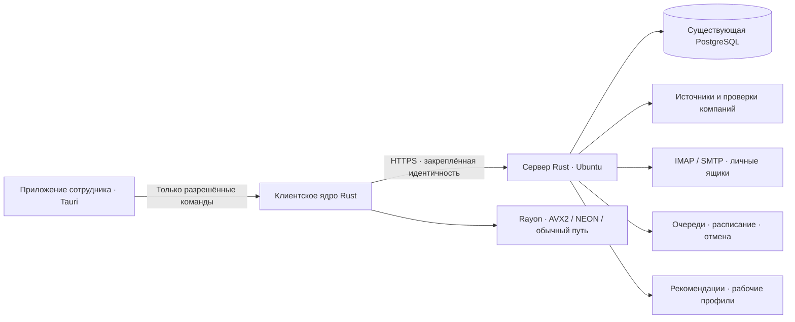

# Переход 1.6.7 → 2.0

**Актуальное решение:** клиент и хост переходят на Rust вместе; клиент использует Tauri. Интерфейс сохраняется из 1.6.7, см. [UI-POLICY.md](UI-POLICY.md). Выпуск промежуточной версии с прежним Python-хостом не согласован. Текущий комплект остаётся тестовым и не опубликован для сотрудников.

## Проверенный этап переноса · 11 ноября 2026

Нативный хост уже работает с PostgreSQL по HTTPS: перенесены авторизация со старыми хешами и сессиями, права по ролям и отделам, карточки и контакты, общая доска руководителей, атомарная передача клиентов с историей, задачи и уведомления, перевозчики, сохранение схем погрузки и калькулятор НДС. Реализованы очередь и расписание поиска, отмена, проверка Чекко, обход каталогов и дедупликация; их нагрузочные и реальные сетевые проверки ещё нужны.

Подключён нативный почтовый модуль: личные ящики и совместимый шифрованный формат паролей, IMAP/SMTP через TLS, папки и вложения, безопасный HTML и посредник загрузки изображений, минутный планировщик, ограничение параллельных соединений и времени операций. Сохранённый кэш 1.6.7 уже читается. Реальные провайдеры, поведение после обрыва во время отправки и все варианты IMAP-ответов ещё требуют отдельных проверок; компиляция не подтверждает их работоспособность сама по себе.

Проверено: 15 модульных тестов Rust-хоста и 10 интеграционных тестов на отдельной PostgreSQL с настоящим TLS. Интеграционный прогон охватывает старый вход, RLS и общий обзор, ревизии добавленных контактов, передачу клиента с сохранением истории, личный почтовый кэш и настройки, освобождение блокировки после ошибки синхронизации, ожидание одобрения регистрации, значимость пробелов в пароле, выдачу интерфейса и защищённую раздачу подготовленного пакета сотрудника, личные схемы погрузки и проверку ревизий. В тестовом хосте отключены внешние запросы; рабочая база не используется. Это не проверка миграции всего установленного приложения.

В клиентском Rust-транспорте сохранён проверенный адрес хоста, подготовлен импорт прежнего защищённого входа Windows/macOS. Восстановление сеанса Windows и повторная проверка TLS подтверждены настоящим тестовым TLS-сервером; всего 8 тестов транспорта. Перенос из связки ключей macOS написан, но на Mac пока не проверен. В хост добавлен UDP-ответ автообнаружения, интерфейс для браузера и потоковая раздача подготовленных сотрудникам пакетов. Это не готовый подписанный установщик обновлений.

### Погрузка: исходная модель, общая сцена и личные схемы

Возвращён корпус исходной пользовательской STL-модели из PackOnTruck: 36 783 треугольника корпуса сохранены целиком, компоненты встроенных колёс и осей отделены при сборке. Подробная исходная модель оси ставится по реальным координатам `sectionAxleLayout`: количество, радиус, высота и положение совпадают со схемой расчёта, в том числе у 4/5/7-осных тралов. Поворот вокруг вертикальной оси Z выключен по умолчанию в новой позиции и импорте; явный выбор в сохранённом грузе сохраняется.

Все площадки и их груз показаны в одной сцене параллельно, бок о бок. Между их габаритами, включая негабаритные свесы, остаётся проход; обычная смена типа не меняет шаг стоянки. Верхнее переключение запускает плавное перемещение камеры на 520 мс без искусственной дуги и перестроения неизменённой геометрии. Смена типа на том же месте учитывает новые габариты, быстрые повторные нажатия отменяют устаревший переход, а правка массы без смены размеров сохраняет вид. Добавлен общий обзор; при уменьшении движения в настройках переход выполняется сразу. Пространственные смещения используются только при отображении: миллиметры груза, опоры и расчёт осей остаются локальными для своей площадки. Зоны, перетаскивание, метки центра тяжести и нагрузки осей учитывают боковое смещение; проход между машинами не считается складом.

Доработка 12 ноября: контур и подпись груза перемещаются вместе с коробкой; неизменившиеся подписи осей сохраняют свои GPU-ресурсы, грузы группируются за один проход перед расчётом подписей. В основном интерфейсе уменьшены отступы, высота навигации, заголовка и сводных карточек; обычная и компактная плотность, светлая и тёмная темы сохранены. Это конкретные исправления и локальные проверки, а не утверждение об отсутствии любых ошибок или завершении переноса 2.0.

После пользовательского сообщения о неработающих действиях исправлены адаптеры оболочки: PNG и JSON схем сохраняются через нативный диалог вместо браузерной ссылки, печатная форма открывается в отдельном окне без разрешений IPC, с запретом скриптов и сетевых ресурсов. В Windows отключён перехват HTML5-перетаскивания со стороны Tauri. В сцене используются захват указателя, завершение жеста при отмене или потере фокуса, плавный масштаб и возврат из ортогонального вида в 3D при вращении; Alt позволяет вращать сцену над грузом. Проверены реальные жесты в Tauri, расчёт 10 паллет, открытие двухстраничного листа и системного диалога PDF, отмена, запись PNG с проверкой содержимого. Добавлены тесты реальных обработчиков ввода и нативной передачи файлов. Это отдельная проверка действий, которую прежние тесты геометрии не заменяли.

Кнопки закрытия редактора разрешают актуальный обработчик при нажатии; Escape теперь проходит через ту же очистку ревизий, а закрытие останавливает опрос настроек и снимает сохранённый обработчик отправки формы. Пять регрессионных тестов проверяют оба действия, Escape, запоздалое сохранение и событие закрытия после повторного открытия. До последней правки кнопка «Закрыть» и крестик над погрузкой сработали при ручной проверке; заявленное непостоянное зависание достоверно не воспроизведено. После остановки Computer Use пользователем последний вариант этой правки ещё не проверен вручную в пересобранной программе.

«Сохранить схему» и «Мои схемы» доступны наверху панели. Схема хранит все машины и контейнеры, груз и расстановку, профили осей, выбранную площадку, единицы, стратегию укладки и вид камеры; формат остаётся совместимым с прежним JSON версии 2. Повреждённый импорт отклоняется до изменения текущей схемы. Персональное хранение и ревизии проверены на нативном хосте; 11 файлов тестов погрузки проходят, исходная модель и совместное отображение двух фур проверены визуально в Tauri.

Пользовательский интерфейс и действующий вычислитель PackOnTruck пока остаются JavaScript из сохранённого приложения. Наличие Tauri и Rust-хоста не означает завершённый перенос самого решателя погрузки на Rust. Локальный интерфейс для визуальных проверок всё ещё может использовать совместимый прежний хост; офисная установка в этих проверках не менялась.

**До выпуска:** закончить совместимый подписанный переход 1.6.7 → 2.0 через существующую кнопку обновления (включая сохранённые локальные сессии, настройки и службу Ubuntu), перенести оставшиеся операции обслуживания/выгрузки/веб-доступа, проверить восстановление и откат, общий поиск четырёх сотрудников и настоящую почту, собрать и проверить Windows/macOS/Linux-пакеты. Публиковать тестовый комплект как готовую 2.0 нельзя. Таблица ниже описывает исходное состояние alpha.1 и критерии приёмки; текущий проверенный этап указан в этом разделе.

## Устройство

### Проверка перехода · 13 ноября 2026

Добавлено Rust-ядро подписанных обновлений и отдельный нативный установщик. Формат Ed25519 ZIP сохранён: настоящий Rust-установщик принимает подготовку Python 1.6.7, проверяет подпись повторно, заменяет файлы программы и восстанавливает резервные файлы при ошибке. Защищённый вход, рабочая PostgreSQL и личные данные не входят в список заменяемых файлов. На временных папках проверены 3 межъязыковых контракта и 6 Rust-тестов, включая подмену файла и запрет понижения версии между подготовкой и установкой.

В Tauri подключены статус, проверка, потоковое скачивание с проверкой размера/SHA256, подготовка и запуск установки после выхода. Поддерживается прежняя задача Windows `check-daily`; между проверками установлен межпроцессный замок. Нативный хост читает исходный EnvironmentFile через преобразователь libpq DSN, использует прежние TLS-ключи, парольные хеши и шифрованную почту. В Ubuntu переход двухэтапный: прежний обновлятель устанавливает совместимый пакет, следующий автоматический повтор привилегированно включает Rust-службу после резервного копирования и проверки закреплённого сертификата. При неудачной проверке восстанавливается команда запуска прежней службы. Три теста оркестрации не управляют настоящим systemd.

Перенесены диагностика, история резервных копий Ubuntu и XLSX-выгрузки личных баз/общего обзора с прежними ограничениями доступа. 12 интеграционных тестов нативного хоста проходят на отдельной PostgreSQL и настоящем TLS. Новый кандидат собирается workflow `native-candidate.yml` для Windows, Ubuntu, Intel Mac и ARM Mac. Полный выпуск и установка на офисном сервере пока не выполнены: остаются проверка готовых пакетов/реального systemd, завершение профиля удалённого подключения и перенос пользовательских настроек/системных уведомлений.

Это целевая архитектура. В alpha.1 десктоп работает с учебной памятью, а сервер предоставляет только отдельную проверку здоровья. Стрелки к рабочей БД, источникам, почте и TLS ещё предстоит реализовать и проверить.

## Что переносим и как принимаем

| Направление | Состояние alpha.1 | Условие готовности |
|---|---|---|
| Tauri, русский интерфейс, темы | Основа и рабочие личные настройки | Нативные проверки Windows / Intel Mac / ARM Mac; весь пользовательский текст на русском, кроме брендов и стандартных обозначений |
| Сервер и PostgreSQL | Только изолированный `/health` | Перенесены авторизация, все операции CRM, транзакции, RLS, события, резервное копирование и служба Ubuntu |
| Поиск по ИНН и критериям | Правила и учебный каталог | Реальные источники, проверки Чекко/ФНС с датами, глобальная дедупликация, 1–50 результатов, остановка, расписание, 4 одновременных сотрудника |
| Клиенты и руководство | Учебный общий обзор, досье и передача | Сохранена реальная история, личные этапы, контакты, часовые пояса; руководитель видит свой отдел, директор всех; поиск доступен каждой должности |
| Задачи и уведомления | Учебное создание задачи и локальные уведомления | Реальные назначения сотрудникам, сроки, повторения, переход в досье, уведомления о просрочке руководству и всплывающие уведомления |
| Перевозчики | Ещё не переносились | Общая база, ИНН после названия, отдельные телефон/почта/условия НДС, автопарк под описанием, тонны/метры, фильтры по направлениям и технике |
| Почта | Макет и модель цепочек; баг исправляется также в 1.x | Ящики сотрудников, папки/вложения/подписи, входящие сверху, ответы и HTML-картинки, 60 секунд автообновления, ограниченные повторы, нет вечной синхронизации |
| Умный подбор | Объяснимые правила и тестируемая малая модель | Профиль собирается из видимых рабочих результатов, есть управление предпочтениями, отложенный поиск и глобальная дедупликация; качество сравнивается с правилами |
| Личные сервисы | Добавление, удаление и сохранение ссылки | Синхронизация личных настроек через хост, подтверждённая изоляция сотрудников, безопасная отдельная область для стороннего сайта |
| Карты, ставки и инструменты | Ещё не переносились | Сохранены все инструменты 1.6.7, нет дублирующего выбора маршрута, есть дата источника ставки, переключатели удобны в обеих темах |
| PackOnTruck | Ещё не переносился | Все существующие тралы и оси, верная геометрия, вращения, ярусы, м/см/мм, т/кг, центр тяжести, нагрузки на каждую ось, сохранение проектов и выгрузка |
| Excel / импорт / экспорт | Ещё не переносились | Открытие в Excel/LibreOffice, защита от формульной инъекции, работа с русскими именами файлов, корректная отмена сохранения |
| Автообновления | Не включены для alpha | Подпись пакета, проверка роли и версии, атомарная замена, откат, автоматический старт хоста, понятный прогресс и обновление сотрудника одной кнопкой |

## Порядок переноса

1. Закрепить начальную сборку и тесты, закрыть подтверждённые причины сбоев 1.x. Снять перечень текущих операций и договориться об измеримых критериях совместимости. **Начато.**
2. Перенести PostgreSQL-доступ и авторизацию на Rust. Сохранить UUID сотрудников и компаний, Argon2id, роли, отдел, права доступа и историю. Пароли и хеши не отдавать приложению; сеанс подтверждает сервер.
3. На восстановленной **копии** базы выполнить сверку количеств записей, владельцев, ИНН, этапов, задач, контактов, автопарков, писем и аудита. Ключи шифрования почты и идентичность сервера сохраняются; иначе пароли ящиков невозможно восстановить без повторного ввода.
4. Перенести поиск и серверный планировщик. Отмена доходит до HTTP-запросов, проверок и очереди; общий пул запросов к источнику ограничен независимо от числа сотрудников. Дубликат исключается атомарной транзакцией/ограничением PostgreSQL, а не только списком в памяти.
5. Завершить CRM, задачи, уведомления, перевозчиков и почту. Старые файлы интерфейса с многократным переопределением обработчиков не переносятся цепочкой: каждый раздел владеет своим состоянием, запросами и жизненным циклом.
6. Перенести расчёты погрузки и проверить их на эталонах: сумма реакций равна общему весу, сумма моментов уравновешена, положение/число осей соответствуют модели, негабарит и центр тяжести не нарушают пределы. Суммарная нагрузка группы не должна выдаваться за точно измеренную нагрузку каждой оси без модели подвески.
7. Подключить сбор рабочей истории для рекомендаций. Начальные правила остаются базовой линией; малая модель используется только при достаточной истории с обоими исходами. Не дообучать модель на её же неподтверждённых предложениях. Показать сотруднику причину рекомендации, руководителю — причину выбора ответственного.
8. Прогнать полный набор проверок на Windows, Ubuntu, Intel и ARM Mac, включая соединение через существующий VPS-туннель, пропадание сети и возобновление работы. Лишь затем выпускать подписанную 2.0 в рабочие ветки.

## Обязательный прогон перед выпуском

- Одна и та же компания не достаётся двум сотрудникам при одновременном поиске. Руководители тоже получают и передают клиентов.
- Быстрые переходы «Клиенты → Перевозчики → Клиенты» и запоздалые ответы не смешивают данные.
- Обрыв IMAP, неверный пароль, медленный сервер, повторная проверка, отказ БД и отмена возвращают конечный статус и освобождают ресурсы.
- Почтовый HTML не запускает сценарии, не читает файлы, не вызывает Tauri-команды и не отслеживает сотрудника удалёнными изображениями без выбранной политики загрузки.
- Один сотрудник не читает чужую почту даже с ролью руководителя; доступ к клиентам проверяется сервером и БД.
- Миграция сохраняет все записи и проверяется восстановлением резервной копии. Процедура отката проверяется до подключения настоящей базы.
- Запуск на машине без AVX2 работает; ARM не получает x86-инструкций; CPU-нагрузка не блокирует интерфейс и отмену.
- Проверяется именно собранный установщик с автоматическим обновлением. Успешная локальная компиляция не считается выпуском.

## Исправление почты в 1.x

Ручная и автоматическая проверки одного ящика объединяются в текущую операцию вместо постоянной ошибки «Почта уже синхронизируется». Блокировки привязаны к точному идентификатору ящика, без случайного конфликта разных ящиков по хешу. Введены абсолютный бюджет IMAP-чтения, бюджет запроса интерфейса, нейтральный статус для старого хоста с 409 и сброс состояния при выходе.

Проверки старого приложения используют отдельную тестовую PostgreSQL и поддельный IMAP. Этот фикс пока находится в исходниках ветки перехода: его ещё нужно отдельно собрать и доставить сотрудникам, если он требуется до выпуска 2.0.
