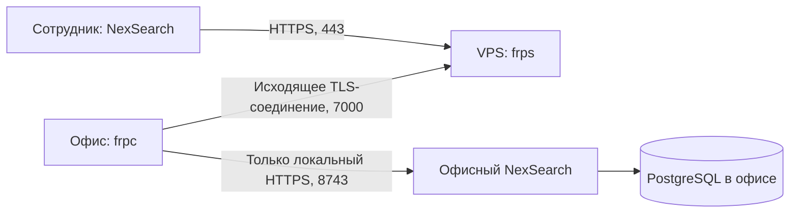

# NexSearch: обратный туннель без VPN

Подготовлено для NexSearch 1.6.6 и frp 0.71.1. Офис подключается исходящим соединением; белый IP и проброс портов в офисе не нужны. Публичный адрес нужен шлюзу: это отдельный VPS. Сотрудникам VPN и frp устанавливать не требуется.

## Что готово, что нужно предоставить

Готовы выбор транспорта приложения, проверка закреплённого сертификата и host_id, автоматическое восстановление, генерация раздельных комплектов и службы Ubuntu. Локальный тест использует настоящие frps/frpc: вход, разделение клиентских баз, Excel, подписанный пакет 3 МБ, обрыв и восстановление, отказ по неверному токену/отсутствующему клиентскому сертификату, защита от повторной записи.

Шлюз `111.88.129.166` установлен и проверен через настоящий frp с изолированным тестовым HTTPS-сервером, включая восстановление и автозапуск после перезагрузки VPS. В `deployment/internet-access.json` задан публичный профиль именно офисного хоста. Офисный Ubuntu ещё не подключён: из текущей домашней сети он недоступен. Сквозной доступ к настоящей офисной базе пока не проверен.

## Подключить существующий офисный сервер из релиза GitHub

В 1.6.7 можно обойтись без ручной загрузки ZIP: после успешного штатного обновления хоста выполните `sudo /opt/nexsearch/venv/bin/python /opt/nexsearch/current/ubuntu/tunnel/install-from-cache.py`. Скрипт берёт OfficeTunnel из Git-кеша существующего обновлятора, проверяет подпись установленным ключом, требует совпадения версии и source_commit с установленным хостом и запускает только проверенный установщик. Новый логин или токен GitHub на сервере не нужен.

Скачайте `NexSearch-1.6.6-Office-Connect.zip`, распакуйте его на офисном Ubuntu, перейдите в `OfficeTunnel` и выполните `sudo bash connect-office.sh`. Установщик проверяет подпись ключом `/etc/nexsearch/updates-public.pem`, расшифровывает настройки существующим ключом `/var/lib/nexsearch/identity/host-key.pem`, проверяет сертификат и идентификатор работающего локального хоста и устанавливает отдельную службу. При несовпадении хоста установка останавливается. Расшифрованные временные файлы удаляются при завершении; рабочая конфигурация хранится с ограниченными правами в `/etc/nexsearch-tunnel`.

GitHub содержит только публичный профиль и зашифрованный комплект. Ключ CA, ключ шлюза и открытые секреты офиса в исходники и релиз не входят. Подписанный архив OfficeTunnel собирается GitHub Actions; сотрудники используют обычные Windows/macOS-комплекты с публичным профилем. На другом хосте расшифровка OfficeTunnel не сработает. Программа хоста обновляется отдельно штатным `nexsearch-update.service`; его база сохраняется.

## Схема



Шлюз передаёт TCP-поток и не завершает HTTPS приложения. Сотрудник проверяет тот же закреплённый сертификат NexSearch и идентификатор хоста, что в локальной сети. Соединение офис—шлюз дополнительно защищено mTLS и отдельным токеном. Открыть через frps другой порт нельзя: разрешён только заданный публичный HTTPS-порт, максимум один на клиента. База, SSH, локальный интерфейс сотрудника на 8765 и служебные панели не публикуются.

## Подготовка оператором

1. Проверить VPS, DNS и доступность из офиса. На VPS должны быть свободны TCP 443 и 7000. Если офис выпускает только на 443, схему входа шлюза нужно адаптировать отдельно; нельзя обещать, что 7000 пройдёт через любой межсетевой экран.
2. Проверить `host_id` и отпечаток реального офисного хоста. Использовать его публичный `client-trust.json`, а не ключи или сертификат локального тестового ПК.
3. Создать секретные комплекты **вне исходников**. Существующий каталог генератор не перезаписывает:

   ```text
   python ubuntu/tunnel/generate.py --domain gateway.example.org --trust network/client-trust.json --output C:\Projects\Nexol\server-deploy\tunnel-office
   ```

   `gateway.example.org` — пример, заменить реальным именем. Публичный IPv4 также поддерживается, но домен позволяет менять адрес шлюза без пересборки клиентского профиля. Домен должен указывать напрямую на VPS, без HTTP-прокси/CDN, завершающего TLS.
4. Отправить каталог `gateway` только на VPS, `office` — только на офисный Ubuntu. Каталог `operator` с ключом CA хранится у оператора отдельно. Секреты не отправлять в чат и не включать в GitHub, USB-комплект сотрудников или приложение.

## Установка на Ubuntu

Сначала проверить комплект без изменений системы:

```text
python3 /путь/к/gateway/install.py --role gateway --bundle /путь/к/gateway
python3 /путь/к/office/install.py --role office --bundle /путь/к/office
```

На каждом соответствующем сервере выполнить его команду с `sudo` и `--install`. Установщик скачивает фиксированную версию frp, проверяет SHA-256, синтаксис, занятость портов, создаёт отдельного служебного пользователя и включает автозапуск. Для установки без скачивания есть `--archive /путь/frp_0.71.1_linux_amd64.tar.gz` с той же обязательной проверкой хеша. Поддерживаются Linux amd64/arm64.

Установщик не меняет PostgreSQL, файлы NexSearch и правила firewall. На VPS отдельно разрешить 443/TCP и 7000/TCP в существующем firewall и сетевых правилах провайдера, сохранив административный SSH. В офисе новые входящие порты не требуются. Один сервер не должен одновременно выполнять обе роли этого комплекта.

Службы: `nexsearch-tunnel-gateway.service` и `nexsearch-tunnel-office.service`. При отказе старта сохраняется предыдущая конфигурация; защищённые снимки находятся в `/opt/nexsearch-tunnel/rollback`. Действующий туннель установщик не перезаписывает: смена ключей выполняется планово.

Проверка:

```text
sudo systemctl status nexsearch-tunnel-office --no-pager
sudo journalctl -u nexsearch-tunnel-office -n 40 --no-pager
```

На VPS использовать имя `nexsearch-tunnel-gateway`. `active` означает живой процесс, а не подтверждение сквозного доступа: отдельно проверить HTTPS NexSearch с его настоящим сертификатом и вход сотрудника.

## Доставка профиля сотрудникам

В `employees` находится единственный публичный `internet-access.json`: URL, версия формата, `host_id`, отпечаток сертификата. Секретов туннеля в нём нет. Его размещают рядом с программой; адрес сотрудник не вводит. Для подписанного обновления оператор помещает этот файл в `deployment/internet-access.json` перед сборкой: Windows и исходные пакеты добавляют профиль, проверяя соответствие хосту. Комплекты для другого тестового хоста его исключают.

В режиме «Автоматически» сначала используется подтверждённая локальная сеть, затем интернет-шлюз. «Через интернет» не подменяется локальным соединением — это позволяет проверить туннель из офиса. В настройках показаны адрес и состояние. Вход остаётся личным, с обычными правами сотрудников.

## Эксплуатация

- Службы запускаются при включении и переподключаются. Клиент проверяет доступность и повторяет соединение с ограниченной задержкой. Сохранение после сетевой ошибки не повторяется автоматически: оно могло уже произойти на сервере.
- Для восстановления нужно питание и интернет у обоих серверов. Устойчивость конкретного провайдера нельзя гарантировать без проверки. Испытать внешнюю сеть/мобильный интернет, перезагрузку офиса и VPS, длительное соединение, почтовые вложения и реальное обновление сотрудников.
- Сертификаты туннеля создаются на 825 дней, CA — на 10 лет. Дата окончания записана в `deployment.json`; обновить их заранее. Сертификат самого NexSearch не заменяется этим комплектом.
- При потере офисного ключа/токена заменить токен на обеих сторонах и переподключить офис; при компрометации CA перевыпустить весь комплект. Универсальный секрет сотрудников не существует.
- Из-за TCP-передачи офисный API видит адрес локального frpc. Действия по учётным записям продолжают журналироваться; внешний IP можно сопоставлять по журналу шлюза. Поддельные `X-Forwarded-For` не используются как доверенная идентификация.

Источники: [mTLS frp](https://gofrp.org/en/docs/features/common/network/network-tls/), [токены из файла](https://gofrp.org/en/docs/features/common/authentication/), [официальный выпуск 0.71.1](https://github.com/fatedier/frp/releases/tag/v0.71.1). Контрольные суммы фиксированы в `frp-release.json`.
