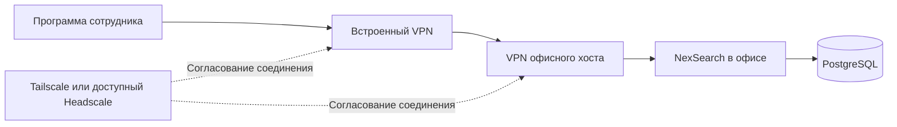

# Удалённый доступ NexSearch

Хост и PostgreSQL остаются на офисном сервере. Программа сотрудника поднимает свой VPN при запуске, без отдельного системного VPN-клиента, TUN-драйвера и прав администратора. По этому каналу она обращается только к NexSearch. Остальные программы и интернет сотрудника продолжают использовать обычное подключение.

## Первое подключение

1. Администратор создаёт сеть организации Tailscale. Для компании выбирается подходящий корпоративный план; бесплатность не предполагается. Устройства сотрудников приглашаются именно в эту сеть.
2. В офисе директор открывает **Настройки → VPN → Офисный хост → Подключить хост**, затем ссылку авторизации. Это подключает сервер, а не компьютер, на котором открыт интерфейс. Если в сети требуется подтверждение устройств, администратор подтверждает хост.
3. Сотрудник открывает установленную программу и нажимает **Подключить VPN** на экране входа либо **Настройки → VPN → Этот компьютер**. Однократно проходит авторизацию в той же сети организации. Затем входит в NexSearch обычным способом.
4. При последующих запусках сохранённое подключение восстанавливается. В офисе действительный локальный адрес предпочтительнее VPN. При недоступном хосте приложение показывает состояние и повторяет попытки.

Первый вход предполагает наличие интернета у сервера и сотрудника. Включение VPN на отключённом от интернета офисном сервере снаружи невозможно. Отзыв устройства, истечение его ключа или политика организации могут потребовать повторной авторизации. Трафик идёт напрямую, когда это возможно, либо через зашифрованный ретранслятор; доступность из любой страны или сети не гарантируется.

Номер хоста основан на уже доверенном UUID NexSearch. Клиент продолжает проверять исходный TLS-сертификат и UUID хоста даже внутри VPN. Перенаправляются только соединения к приложению; PostgreSQL, SSH, общие папки и другие компьютеры офиса не публикуются. Физический IP сотрудника при этом не обязан совпадать с подсетью офиса.

## Headscale

Вместо Tailscale можно выбрать **Свой Headscale** и указать HTTPS-адрес. На хосте и сотрудниках указывается один сервер и одна разрешённая сеть. Координационный сервер должен быть доступен обоим из интернета; находящийся только в частной офисной сети Headscale эту задачу сам по себе не решает. Сам офисный NexSearch может оставаться за NAT без публичного IP и проброса его портов.

Доступ к серверу NexSearch регулируют его аккаунты, роли и закрепление клиентов. Дополнительно администратор VPN может ограничить ACL только портом приложения 8743, отозвать устройство и настроить срок действия его ключей. В комплекте нет общего ключа регистрации или учётной записи администратора VPN.

## Сборка и обслуживание

Модуль использует `tailscale.com/tsnet`, зафиксированный в `go.mod` и `go.sum`. Для Windows/Linux нужен Go 1.27.1 или новее, tsnet 1.104.1. Для Mac используется отдельный закреплённый модуль `macos/go.mod`: tsnet 1.102.4 и Go 1.26.9, чтобы сохранить macOS 12 Monterey и MacBook Pro 2016 (Go 1.27 требует macOS 13). `python vpn/build.py` собирает Windows x64, Ubuntu Linux x64, Mac Intel и Apple Silicon. Можно указать только нужные платформы. Переменная `NEXSEARCH_GO` позволяет выбрать Go без изменения системного PATH; совместимый инструмент Go 1.26.9 для Mac загружается механизмом Go toolchain с проверкой контрольных сумм. `go test ./...` запускается из `vpn`; Mac-модуль также проверяется в подготовленном `build/vpn-macos` с `GOTOOLCHAIN=go1.26.9` на архитектуре системы сборки.

Windows-сборка включает модуль в EXE. Подписанные обновления Ubuntu и macOS включают только свои платформы. GitHub Actions собирает модули перед подписью; собранные бинарные файлы не хранятся в исходной ветке. Супервизор Python запускает модуль дочерним процессом, отслеживает его состояние и повторяет запуск при сбое. На Ubuntu он запускается вместе с существующей службой NexSearch, без отдельной системной VPN-службы.

Настройки и собственное состояние устройства находятся в каталоге данных соответствующего приложения, отдельно от исходников и дистрибутива. Файлы состояния tsnet содержат ключи устройства: их нельзя переносить другим сотрудникам или включать в общие обновления и резервные копии дистрибутива. На Unix каталоги закрываются правами 0700. Облачные пароли и административные API-ключи в программу не вводятся. Авторизация происходит на странице провайдера; личные данные входа NexSearch в неё не передаются.

Локальные тесты проверяют разрешённые адреса, права ролей, Origin/CSRF, восстановление процесса, предпочтение LAN, проверку UUID и сертификата, непрозрачную передачу байтов и состав пакетов. Реальное подключение офисного сервера и удалённого сотрудника проверяется после однократной авторизации владельцем сети. Кросс-компиляция для Linux/macOS не заменяет запуск на этих системах.

Документация: [tsnet](https://tailscale.com/docs/reference/tsnet-server-api), [тарифы организации](https://tailscale.com/pricing), [требования Headscale](https://headscale.net/stable/setup/requirements/). Tailscale распространяется под BSD-3-Clause; лицензия поставляется рядом с исходниками модуля.
